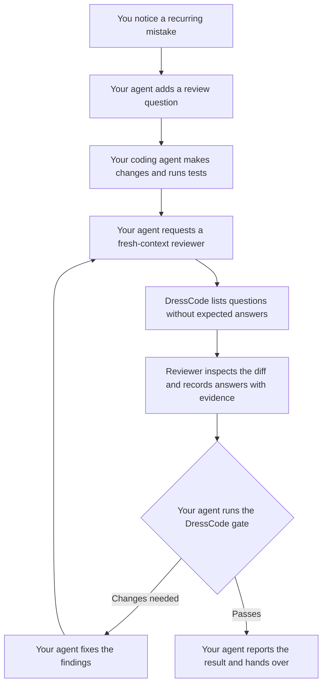

# DressCode

**Instructions get ignored. Gates demand answers.**

Your coding agent makes the same mistake again. You add another instruction.
It happens again anyway.

DressCode turns those mistakes into yes/no review questions. Before your agent
calls the work done, a fresh reviewer must answer each question with evidence.
The gate checks those answers against the current changes.

In the author's tests, agents followed the DressCode workflow in situations where
they ignored a skill containing the same instructions. The difference was asking
them to demonstrate their effort against each question before passing a gate.

## Turn a mistake into a question

Tell your agent:

> You created another test helper when we already have one. Add a DressCode
> question so future reviews check for that.

Your agent adds a question to the repository:

```sh
dresscode add shared-builder \
  --question "When adding test setup, did you reuse an existing shared builder where suitable?" \
  --expects true \
  --reveal "Prefer the shared builder over duplicating test setup."
```

On later changes, the reviewer sees the question, without the expected answer
or explanation. Those appear only after it records a verdict with evidence.
If the code changes after review, the answers become stale and need a new review.

## How it fits together



Your agent or harness runs this workflow. DressCode records and checks the
answers; it does not launch the reviewer or verify its independence.

## Set up once

1. Install from a DressCode checkout. Requires [uv](https://docs.astral.sh/uv/)
   and Python 3.14:

   ```sh
   uv tool install .
   ```

2. Generate the agent skill and install it using your harness's skill mechanism:

   ```sh
   dresscode --skill > SKILL.md
   ```

   Configure your harness to use it and require a passing gate before hand-over.
   See [agent integration](docs/manual.md#agent-integration) for the instruction
   to add to your target project.

   When installed from supported HTTPS or SSH Git metadata, the export pins the
   install URL and resolved commit. SSH URLs use `ssh://[user@]host[:port]/path`;
   usernames and ports are preserved, but passwords are rejected. SSH installs
   use your SSH configuration and keys. Otherwise the export uses the official
   unpinned command, which may not match the installed version.

3. In your **target Git repository**, ask your agent to add the first question,
   like the test-helper example above. Questions start empty; an empty gate passes
   without reviewing anything.

## What your agent runs

You ask for a change. Your agent implements it, runs tests, then arranges review:

| When | Command | Who and why |
|---|---|---|
| Prepare review | `dresscode diff --json` | Your agent identifies the review scope, then gives the actual code diff to a fresh reviewer. |
| Get questions | `dresscode list --json` | The reviewer gets the questions and any configured context evidence. |
| Record each verdict | `dresscode answer <id> --yes --evidence "<findings>"` | The reviewer records its judgment; use `--no` or `--n-a` where appropriate. |
| Before hand-over | `dresscode check` | Your agent requires current passing answers, fixes findings and arranges another review when needed. |
| Show the result | `dresscode report` | Your agent reports the verdicts and evidence to you. |

For a **review-only request**, the reviewer records answers and reports findings.
It does not edit code, grant exceptions or run the hand-over gate.

Use DressCode for judgments that need project context. Keep tests, linters and
type checks for things they can verify automatically.

See the [manual](docs/manual.md) for configuration, context commands, accepted
exceptions and command details, or [development](docs/manual.md#development)
to work on DressCode itself.
